<div class="titlepage">

<p class="kicker">Unit V Assignment - Exploring GUI Frameworks (PyQt, Kivy &amp; Alternatives)</p>

# Student Record Manager { .unnumbered }

<p class="subtitle">A PyQt6 desktop application, with a comparative study of Python GUI frameworks</p>

| | |
|---|---|
| **Name** | Sangay Rinchen |
| **Roll number** | 08230185 |
| **Course / Module** | Your course code and title |
| **Instructors** | Anup Gurung, Purba Dorji Tamang &amp; Sangay Thinley |
| **Date** | November 2026 |
| **Framework used** | PyQt6 6.12 on Python 3.13 |

</div>

## 1. Abstract

The Student Record Manager is a desktop application for a small department office. Staff use it to keep student records and marks for four modules. A user can add, edit, search, filter and delete students. The app calculates each student's average and letter grade, flags students who failed any module, and shows a summary tab with the class average, pass rate and a bar chart of average marks per subject. Records are saved to a JSON file after every change, so data survives restarts. A damaged data file is backed up instead of crashing the app. The application is written in **PyQt6**, chosen after comparing six Python GUI frameworks (PyQt/PySide, Kivy, Tkinter, wxPython, Gradio and Streamlit) on licence, platforms, widget set, layout, event model, styling, tooling, packaging, learning curve and community. The code is split into a UI layer (`srm/ui`) and a PyQt-free logic/data layer (`srm/models.py`, `srm/storage.py`). The project includes 9 unit tests and 15 recorded GUI test cases, all passing. It also delivers the stretch goals: search/filter, a chart, and a PyInstaller executable (60 MB, about 1.4 s to start).

## 2. Introduction

**Problem statement.** Many small departments still keep marks in loose spreadsheets. Spreadsheets have no input validation (a mistyped ID or a mark of 150 goes unnoticed), make searching awkward, and let anyone overwrite a row by accident. A small purpose-built desktop tool can enforce valid data, confirm destructive actions and give an instant class summary.

**Scope.** A single-user, offline desktop application that:

- stores students with ID, name, gender, programme, year, email, date of birth, enrolment status and marks for four subjects;
- supports create, read, update and delete, plus search by name/ID, filter by programme and filter by minimum average;
- validates every field and explains errors in plain language;
- persists data in `data/students.json` and can export to CSV;
- shows summary statistics and a per-subject chart.

Out of scope: multi-user access, networking, login and printing.

**Target users.** Programme coordinators and administrative staff who are comfortable with a desktop computer but are not programmers. The app therefore uses plain labels, keyboard shortcuts for common actions (Ctrl+N, Ctrl+E, Ctrl+Q) and confirmation before deletion.

## 3. Framework study

### 3.1 Framework profiles (A1)

**PyQt (PyQt6) and PySide6**
PyQt is a set of Python bindings for the C++ **Qt** toolkit, made by Riverbank Computing (Phil Thompson) since 1998; PyQt6 targets Qt 6. **PySide6** ("Qt for Python") is the official binding maintained by The Qt Company, with an almost identical API. The key difference is the **licence**. PyQt is **GPL v3 or commercial**: if you distribute a closed-source PyQt app you must buy a commercial licence. PySide6 is **LGPL v3**, which allows closed-source distribution as long as Qt is dynamically linked and replaceable. Platforms: Windows, macOS and Linux desktop, plus embedded Linux. Android/iOS are possible through Qt but not a mainstream route for Python. Widget richness is the highest of any Python toolkit: tables and tree views with a model/view architecture, docks, MDI, rich text, charts (QtCharts), a web engine, multimedia, SVG and OpenGL. The UI can be written in Python code, designed visually in **Qt Designer** (saved as `.ui` XML files loaded with `uic`), or declared in **QML/Qt Quick** for fluid, touch-friendly interfaces. Events use **signals and slots**; appearance is controlled by **Qt Style Sheets** (CSS-like). Typical applications: professional desktop tools such as Anki, Calibre, Spyder, the Orange data-mining suite and many scientific and engineering GUIs.

**Kivy**
Kivy is an open-source framework started in 2010 (growing out of PyMT) and maintained by the Kivy organisation, under the permissive **MIT licence**. It does not use native widgets. Everything is drawn with **OpenGL ES 2** through its own graphics pipeline, with SDL2 for windows and input. Its strength is **cross-platform touch**: one codebase runs on Windows, macOS, Linux, Raspberry Pi, **Android** (via python-for-android and Buildozer) and **iOS** (kivy-ios), with multi-touch and gestures built in. The widget set is moderate (Label, Button, TextInput, Spinner, Slider, ProgressBar, RecycleView, Popup, FileChooser, TabbedPanel); KivyMD adds Material Design widgets. UIs are written in Python or in the declarative **KV language** (`.kv` files), which binds properties automatically. Events use `bind()` and Kivy **properties** that notify observers. Default widgets look non-native, which suits games and kiosks but looks out of place in office software. Typical applications: mobile apps, kiosks, multimedia and touch-screen installations, educational games.

**Tkinter**
Tkinter is Python's **standard-library** GUI package, a wrapper over **Tcl/Tk** (Tk created by John Ousterhout). It ships with python.org installers, so there is nothing to `pip install`; on some Linux distributions it is a separate package (`python3-tk`). Licence: Python Software Foundation licence (Tk itself is BSD-style), so it is free for any use. Platforms: Windows, macOS and Linux desktop only, with no mobile or touch support. The basic widget set is small (Label, Button, Entry, Text, Canvas, Listbox, Scale, Menu, Checkbutton, Radiobutton). The **ttk** themed widgets add Combobox, Notebook, Treeview and Progressbar with a more native look. UIs are written in code only; there is no official designer, though third-party tools exist. Layout uses three geometry managers: `pack`, `grid` and `place`. Events use the `command=` callback or `widget.bind("<Event>", handler)`. Typical applications: teaching, small utilities, IDLE (Python's own editor), quick internal tools.

**wxPython**
wxPython wraps the C++ **wxWidgets** library (started by Julian Smart in 1992); the Python binding is led by Robin Dunn, and the current "Phoenix" series is wxPython 4. Licence: **wxWindows Library Licence**, essentially LGPL with an exception that allows static linking, so commercial closed-source use is fine. Its defining feature is **native widgets**: on Windows it uses Win32 controls, on macOS Cocoa and on Linux GTK, so apps look exactly like the host OS. Desktop only. The widget set is rich (grids, tree lists, AUI docking, HTML window, property grid, STC code editor). The UI is written in code or designed with **wxFormBuilder** or **wxGlade**, which generate Python or XRC (XML). Layout uses **sizers** (BoxSizer, GridBagSizer). Events use `Bind(wx.EVT_BUTTON, handler)`. Its community and release pace are smaller than Qt's. Typical applications: native-looking desktop tools and some installers.

**Gradio**
Gradio is an open-source library created in 2019 and acquired by **Hugging Face** in 2021, under the **Apache 2.0** licence. It is not a desktop toolkit: it starts a local web server, and the UI runs in a **browser** (so it works on any device that can open the page, including phones). You describe inputs and outputs (`gr.Textbox`, `gr.Image`, `gr.Slider`, `gr.Dataframe` and more) and connect them to a Python function with `gr.Interface` or the more flexible `gr.Blocks`. Events are wired with `.click()` / `.change()` listeners. Styling is limited to themes and custom CSS. Apps are shared with a temporary public link or hosted on Hugging Face Spaces, and cannot be packaged as a native executable. Typical applications: machine-learning model demos and quick internal tools around a single function.

**Streamlit**
Streamlit is an open-source framework (Apache 2.0) released in 2019 by Streamlit Inc., acquired by **Snowflake** in 2022. Like Gradio it serves a **web page**. Its unusual model is that the **whole script re-runs top to bottom** on every interaction; widgets such as `st.button` simply return their current value, and `st.session_state` keeps data between runs. It has strong data widgets (`st.dataframe`, `st.data_editor`, built-in charts, Altair/Plotly support) and a column/tab/sidebar layout. Styling is through a theme file. Deployment is to Streamlit Community Cloud or any server. Typical applications: data dashboards, analytics reports and internal data tools.

<div class="wide matrix">

### 3.2 Comparison matrix (A2)


| Framework | Licence | Platforms | Widget set | Layout system | Event model | Styling / theming | Designer tooling | Packaging / deployment | Learning curve | Community | Best suited for |
|---|---|---|---|---|---|---|---|---|---|---|---|
| **PyQt6 / PySide6** | PyQt: GPL v3 or commercial. PySide6: LGPL v3 | Win, macOS, Linux; embedded; mobile possible via Qt but uncommon | Very rich (model/view tables, docks, charts, web engine) | QVBox/QHBox/QGrid/QForm layouts, splitters | Signals and slots | Qt Style Sheets (CSS-like), QPalette, QML | Qt Designer (`.ui`), Qt Creator | PyInstaller, Nuitka, briefcase; 40-100 MB | Moderate to steep | Very large; long history | Professional desktop apps, data-heavy forms and tables |
| **Kivy** | MIT | Win, macOS, Linux, Android, iOS, Raspberry Pi | Moderate; KivyMD adds Material widgets | BoxLayout, GridLayout, FloatLayout, AnchorLayout, StackLayout | `bind()`, Kivy properties, KV bindings | KV language rules, canvas instructions | KV language; no official visual designer | Buildozer (Android), kivy-ios, PyInstaller | Moderate (KV is new) | Medium | Touch and mobile apps, kiosks, games |
| **Tkinter** | PSF (Tk: BSD-style) | Win, macOS, Linux | Small; better with ttk | pack, grid, place | `command=` callbacks, `bind()` | ttk themes, limited | None official | PyInstaller; small (about 10 MB) | Easy | Very large (teaching) | Learning, small utilities, scripts |
| **wxPython** | wxWindows Library Licence (LGPL-like) | Win, macOS, Linux | Rich, **native** controls | Sizers (Box, Grid, GridBag) | `Bind(EVT_..., handler)` | Mostly native look; little custom theming | wxFormBuilder, wxGlade | PyInstaller; medium size | Moderate | Small to medium | Native-looking desktop tools |
| **Gradio** | Apache 2.0 | Any browser (server in Python) | ML-oriented inputs/outputs | Rows, Columns, Tabs in `gr.Blocks` | `.click()` / `.change()` listeners to functions | Themes, custom CSS | None (code only) | Share link, Hugging Face Spaces; no native exe | Very easy | Large (ML community) | ML model demos |
| **Streamlit** | Apache 2.0 | Any browser (server in Python) | Strong data widgets and charts | Columns, tabs, sidebar, containers | Script re-runs on every interaction; `session_state` | Theme config, limited CSS | None (code only) | Community Cloud, any server; no native exe | Very easy | Large (data community) | Dashboards, data apps |

</div>

### 3.3 Hello-world evidence (A3)

The same program, a label plus a "Click me" button that counts clicks, was written and run in three frameworks. Source files are in `partA/`. Each screenshot was taken after clicking the button.

```python
# partA/hello_pyqt.py  (PyQt6)
app = QApplication(sys.argv)
window = QWidget(); window.setWindowTitle("Hello PyQt6")
label = QLabel("Hello, PyQt6!"); button = QPushButton("Click me")
def on_click():
    global clicks; clicks += 1
    label.setText(f"Button clicked {clicks} time(s)")
button.clicked.connect(on_click)            # signal -> slot
layout = QVBoxLayout(window); layout.addWidget(label); layout.addWidget(button)
window.show(); sys.exit(app.exec())
```

```python
# partA/hello_kivy.py  (Kivy)
class HelloApp(App):
    def build(self):
        root = BoxLayout(orientation="vertical", padding=10, spacing=10)
        self.label = Label(text="Hello, Kivy!"); button = Button(text="Click me")
        button.bind(on_press=self.on_click)  # event binding
        root.add_widget(self.label); root.add_widget(button)
        return root
    def on_click(self, instance):
        self.clicks += 1
        self.label.text = f"Button clicked {self.clicks} time(s)"
HelloApp().run()
```

```python
# partA/hello_tkinter.py  (Tkinter)
root = tk.Tk(); root.title("Hello Tkinter")
label = tk.Label(root, text="Hello, Tkinter!")
def on_click():
    global clicks; clicks += 1
    label.config(text=f"Button clicked {clicks} time(s)")
button = tk.Button(root, text="Click me", command=on_click)  # callback
label.pack(pady=10); button.pack()
root.mainloop()
```

<div class="shots3">

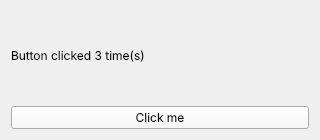

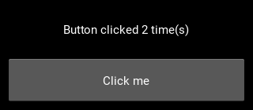

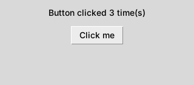

</div>
<p class="caption">Figure 1 - Running windows after clicking: PyQt6 (left), Kivy (centre), Tkinter (right).</p>

**What felt different.** Tkinter needed the least code: one import, no application object, and the callback passed straight to the button with `command=`. PyQt needed an explicit `QApplication`, a layout object and a `clicked.connect(...)` call. That is more boilerplate, but it states clearly which signal triggers which slot. Kivy pushed me into a class structure (`App` subclass with `build()`), and its default dark theme with huge stretched buttons looks nothing like a desktop app. Kivy also prints a long block of start-up logging and took noticeably longer to open because it initialises OpenGL. Event wiring is conceptually the same in all three (attach a function to the button), only the syntax differs: `command=`, `bind(on_press=...)` and `clicked.connect(...)`.

### 3.4 Recommendation (A4)

I chose **PyQt6** for the Student Record Manager. The decision follows from the matrix rather than personal preference:

1. **Widget set.** A record manager is built around a sortable, selectable table plus a form with spin boxes, a date picker, combo boxes and radio buttons. Qt provides every one of these out of the box (`QTableWidget`, `QDateEdit` with a calendar pop-up, `QSpinBox` with range clamping). Kivy has no built-in data table, and Tkinter's `ttk.Treeview` and lack of a date picker would mean extra work.
2. **Layout system.** Qt's `QGridLayout`, `QFormLayout` and `QSplitter` align labels and fields automatically and resize gracefully, which the assignment explicitly requires.
3. **Styling.** Qt Style Sheets let one CSS-like file restyle the whole app from a small set of colour tokens, so it does not look like the default skin. Tkinter's theming is far more limited.
4. **Event model.** Signals and slots (`textChanged`, `itemSelectionChanged`, `valueChanged`) map directly onto the interactions a records app needs, such as live search and selecting a row to edit.
5. **Platforms and packaging.** The users are office staff on Windows/Linux desktops, so Kivy's mobile strength brings nothing here, while PyInstaller packages PyQt cleanly.

The cost is licensing: PyQt is GPL, so a closed-source commercial release would need a paid licence or a switch to **PySide6** (LGPL), whose API is almost identical. **When another framework would be better:** if the department wanted teachers to enter marks on **Android tablets** in the classroom, **Kivy** would be the right choice for its touch support and Android packaging. If the goal were only an online dashboard of results viewed in a browser, **Streamlit** would deliver it in a fraction of the code.

## 4. System design

### 4.1 Feature list

| # | Feature | Where |
|---|---|---|
| F1 | Add a student with personal details and four marks | Records tab, form |
| F2 | Select a row to load it into the form; Update or Delete it | Records tab |
| F3 | Delete with a Yes/No confirmation dialog | Records tab |
| F4 | Live search by name or ID; filter by programme; minimum-average slider | Records tab, filter bar |
| F5 | Automatic average, letter grade (A-F) and pass/fail (all marks >= 40) | Logic layer |
| F6 | Validation of every field with a red highlight, an inline message and a dialog | Form |
| F7 | Auto-save to JSON after every change; corrupt-file recovery | Data layer |
| F8 | Export to CSV (File > Export, Ctrl+E) with a file-save dialog | Menu |
| F9 | Summary tab: count, class average, pass rate bar, per-subject bar chart | Summary tab |
| F10 | About dialog with student name and roll number | Help menu |

### 4.2 Wireframes

The screens were sketched before coding. The sketches decided the split between a fixed-width form on the left and a stretching table on the right, and the separate Summary tab.

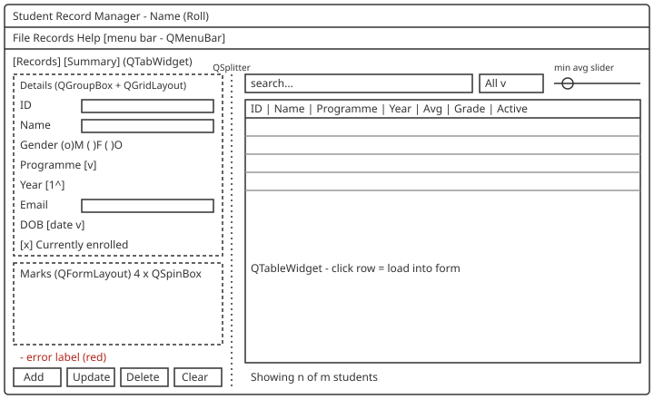{ .wf }

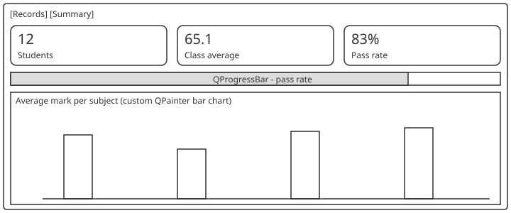{ .wf }

### 4.3 Widget-and-layout plan

| Area | Layout manager | Widgets |
|---|---|---|
| Main window | `QMainWindow` with `QMenuBar`, `QStatusBar`, central `QTabWidget` | Menu actions (Export, Exit, New, About) |
| Records tab | `QSplitter` (horizontal) | Form panel, table panel |
| Student details | `QGridLayout` (label column + field column) inside `QGroupBox`; `QHBoxLayout` for gender | `QLineEdit` x3, `QRadioButton` x3, `QComboBox`, `QSpinBox`, `QDateEdit`, `QCheckBox` |
| Marks | `QFormLayout` inside `QGroupBox` | 4 x `QSpinBox` (0-100) |
| Buttons | `QHBoxLayout` | `QPushButton` x4 (Add, Update, Delete, Clear) |
| Table panel | `QVBoxLayout` + `QHBoxLayout` filter bar | `QLineEdit` (search), `QComboBox` (filter), `QSlider`, `QLabel`, `QTableWidget` |
| Summary tab | `QVBoxLayout` + `QHBoxLayout` of cards | `QFrame` cards with `QLabel`, `QProgressBar`, custom `BarChart` widget |

That is **16 distinct widget types**: QLabel, QLineEdit, QPushButton, QComboBox, QSpinBox, QDateEdit, QCheckBox, QRadioButton, QTableWidget, QSlider, QProgressBar, QTabWidget, QGroupBox, QSplitter, QMenuBar, QStatusBar, plus a custom-painted chart. It uses **6 layout managers**: QVBoxLayout, QHBoxLayout, QGridLayout, QFormLayout, QSplitter and QTabWidget.

### 4.4 Data design

Records are stored as JSON in `data/students.json`. One object per student, keyed by an 8-digit ID that must be unique:

```json
{
  "version": 1,
  "students": [
    {
      "student_id": "02230001",
      "name": "Tashi Dorji",
      "gender": "Male",
      "programme": "BSc IT",
      "year": 1,
      "email": "tashi.dorji@example.edu.bt",
      "dob": "2002-01-10",
      "active": true,
      "marks": {"Programming": 65, "Mathematics": 54, "Databases": 70, "English": 86}
    }
  ]
}
```

| Field | Type | Rule |
|---|---|---|
| student_id | string | exactly 8 digits, unique |
| name | string | 2-60 letters; spaces . ' - allowed |
| gender | string | Male / Female / Other |
| programme | string | one of 5 programmes |
| year | int | 1-4 |
| email | string | optional; must look like name@domain.tld |
| dob | ISO date | age 15-80 |
| active | bool | - |
| marks | object | 4 subjects, each 0-100 |

Average, grade and pass/fail are **derived**, not stored, so they can never disagree with the marks.

### 4.5 Architecture

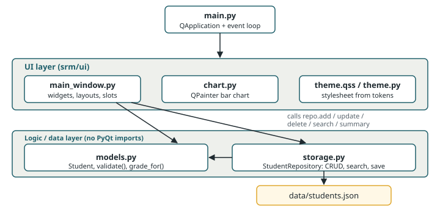{ .wf }

The UI layer (`srm/ui`) never reads or writes files; it calls the `StudentRepository`. The logic/data layer imports nothing from PyQt, so it can be unit-tested without a display and could be reused under a Kivy or web front end.

## 5. Implementation

**R1 - Main window with title, size and menu bar.** `MainWindow` subclasses `QMainWindow`. The title includes the student's name and roll number from `srm/config.py`.

```python
self.setWindowTitle(config.WINDOW_TITLE)    # "Student Record Manager - Name (Roll)"
self.resize(1180, 720)
self.setMinimumSize(900, 560)               # never squashed below a usable size
file_menu = self.menuBar().addMenu("&File")
export = QAction("&Export to CSV...", self, shortcut=QKeySequence("Ctrl+E"))
export.triggered.connect(self.on_export_csv)
```

**R2 - At least 8 widget types.** 16 are used (see 4.3). For example, the marks box creates one `QSpinBox` per subject, so QSpinBox's built-in range limit is the first line of validation:

```python
marks_form = QFormLayout(marks_box)
for subject in config.SUBJECTS:
    spin = QSpinBox(minimum=0, maximum=100)  # can't type 150: Qt clamps it
    self.mark_spins[subject] = spin
    marks_form.addRow(subject, spin)
```

**R3 - Layout managers and graceful resizing (layout example).** The form uses a `QGridLayout` so all labels share one column and all fields another. Column 1 is given the stretch, so only the fields grow. A `QSplitter` puts the form beside the table; stretch factors keep the form's width fixed while the table absorbs extra space (see the resized screenshot, Figure 12).

```python
grid = QGridLayout(details)                  # 2 columns: label | field
grid.setHorizontalSpacing(12)
for r, (label, w) in enumerate(rows):
    grid.addWidget(QLabel(label), r, 0)
    if isinstance(w, QHBoxLayout):           # gender radio buttons row
        grid.addLayout(w, r, 1)
    else:
        grid.addWidget(w, r, 1)
grid.setColumnStretch(1, 1)                  # only the field column grows

splitter = QSplitter(Qt.Orientation.Horizontal)
splitter.addWidget(self._build_form())
splitter.addWidget(self._build_table_panel())
splitter.setStretchFactor(0, 0)              # form keeps its width
splitter.setStretchFactor(1, 1)              # table takes the extra space
```

**R4 - Event handling with signals and slots (14 handled events).** Each widget's signal is connected to a method (slot) of the window. The live search shows the pattern: `textChanged` fires on every keystroke, and the slot re-queries the repository.

```python
self.add_btn.clicked.connect(self.on_add)                    # 1
self.update_btn.clicked.connect(self.on_update)              # 2
self.delete_btn.clicked.connect(self.on_delete)              # 3
self.clear_btn.clicked.connect(self.clear_form)              # 4
self.search_edit.textChanged.connect(self.refresh_table)     # 5 live search
self.filter_combo.currentIndexChanged.connect(self.refresh_table)  # 6
self.min_slider.valueChanged.connect(self.on_min_changed)    # 7
self.table.itemSelectionChanged.connect(self.on_row_selected)  # 8
tabs.currentChanged.connect(self.refresh_summary)            # 9
# + 4 QAction.triggered (Export, Exit, New, About) and closeEvent()

def on_min_changed(self, value: int) -> None:   # slot receives the new value
    self.min_label.setText(f"Min avg: {value}")
    self.refresh_table()
```

**R5 - Dialogs.** The app uses a confirmation (`QMessageBox.question`) before delete, a warning dialog for validation errors, critical dialogs for file errors, `QFileDialog.getSaveFileName` for CSV export, and an About box.

```python
answer = QMessageBox.question(
    self, "Delete student", f"Delete {s.name} ({s.student_id})?\nThis cannot be undone.",
    QMessageBox.StandardButton.Yes | QMessageBox.StandardButton.No,
    QMessageBox.StandardButton.No)            # default = No, safer
if answer != QMessageBox.StandardButton.Yes:
    return
```

**R6 - Input validation with friendly feedback.** `validate()` in the logic layer collects *all* problems at once and raises one `ValidationError`. The UI catches it, turns each bad field red through a dynamic property, lists the messages under the form and shows a dialog. The app never crashes on bad input.

```python
def validate(student: Student) -> None:
    errors = []
    if not STUDENT_ID_RE.match(student.student_id):
        errors.append(("student_id", "Student ID must be exactly 8 digits, e.g. 02230045."))
    if student.email and not EMAIL_RE.match(student.email):
        errors.append(("email", "Email is not valid, e.g. name@rub.edu.bt."))
    ...
    if errors:
        raise ValidationError(errors)

# UI side (_show_errors): mark the widget so the stylesheet rule *[invalid="true"] applies
w.setProperty("invalid", True)
w.style().unpolish(w); w.style().polish(w)   # re-apply stylesheet
```

**R7 - Data persistence.** `StudentRepository.save()` runs after every add, update or delete, and once more in `closeEvent`. It writes to a temporary file and then renames it, so a crash mid-save cannot leave a half-written file. If the JSON cannot be read at start-up, a backup is kept and the user is warned.

```python
def save(self) -> None:
    payload = {"version": 1, "students": [s.to_dict() for s in self.all()]}
    try:
        self.path.parent.mkdir(parents=True, exist_ok=True)
        tmp = self.path.with_suffix(".tmp")
        tmp.write_text(json.dumps(payload, indent=2), encoding="utf-8")
        tmp.replace(self.path)                # atomic replace
    except OSError as exc:
        raise StorageError(f"Could not save data: {exc.strerror}") from exc
```

Paths come from `config.py` and are built relative to the project (or, inside a PyInstaller executable, to the executable's folder). There are no hard-coded absolute paths.

**R8 - Styling and theming.** `srm/ui/theme.qss` is a Qt Style Sheet built from a small design system: a warm paper background, a deep-teal primary colour, a saffron accent for data, and red for danger. Buttons get roles through `objectName`:

```css
QPushButton#primary { background: #1f5f6b; color: #ffffff; border: none; }
QPushButton#danger  { background: #ffffff; color: #b3261e; border: 1px solid #b3261e; }
*[invalid="true"]   { border: 2px solid #b3261e; background: #fbe9e7; }
QProgressBar::chunk { background: #e0a82e; border-radius: 3px; }
QTableWidget { alternate-background-color: #eef0ec; selection-background-color: #1f5f6b; }
```

**R9 - Separation of UI and logic/data.** `srm/models.py` (Student, `validate`, `grade_for`) and `srm/storage.py` (`StudentRepository`) contain no PyQt imports. `srm/ui/main_window.py` only converts between widgets and `Student` objects (`_form_to_student`, `_student_to_form`) and calls repository methods. This is why the logic could be unit-tested with plain `unittest` (section 6).

**Stretch goals.** (a) Search and filter: text, programme and minimum average combined in `StudentRepository.search()`. (b) Chart: `srm/ui/chart.py` draws the per-subject averages with `QPainter` in `paintEvent`, so no extra library is needed. (c) PyInstaller: a one-file Linux executable of **60 MB** (62,427,048 bytes). Measured from launch until the window appeared (median of 3 runs on the same machine), it starts in **1.40 s**, against 0.37 s for `python main.py`. The extra second is the one-file bundle unpacking itself to a temporary folder on each start.

## 6. Testing

Testing was done at two levels. **Unit tests** (`tests/test_logic.py`, 9 tests) check the logic and data layers without a GUI: all 9 pass. **GUI test cases** were executed by `tools/gui_tests_and_screenshots.py`, which drives the real `MainWindow` (filling fields, clicking buttons, selecting rows) on a temporary copy of the sample data. The *Actual* column below is the text the script recorded during the run, not a prediction.

<div class="wide">

| # | Action | Input | Expected | Actual | Pass/Fail |
|---|---|---|---|---|---|
| 1 | Add a new student | 02230099, Dawa Lhamo, valid email, marks 78/66/81/72 | Row added; status bar confirms; count +1 | Added; 13 records; status: 'Added Dawa Lhamo (02230099)' | Pass |
| 2 | Close and reopen data file | - | Dawa Lhamo still present after reload | Found after reload | Pass |
| 3 | Add with invalid Student ID **(invalid)** | ID '12ab' | Error dialog; ID field highlighted red; nothing saved | Dialog 'Please check the form': Student ID must be exactly 8 digits, e.g. 02230045. | Pass |
| 4 | Add with empty name **(invalid)** | Name '' | Error 'Name must be 2-60 letters' | Name must be 2-60 letters (spaces, . ' - allowed). | Pass |
| 5 | Add with invalid email **(invalid)** | Email 'dawa@' | Error 'Email is not valid' | Email is not valid, e.g. name@rub.edu.bt. | Pass |
| 6 | Add with an ID that already exists **(invalid)** | ID 02230001 | Error 'already exists'; original record unchanged | Student ID 02230001 already exists. | Pass |
| 7 | Add with date of birth giving age < 15 **(invalid)** | DOB 2024-01-01 | Error about age range | Date of birth gives an age outside 15-80 years. | Pass |
| 8 | Type 150 into a mark spin box **(invalid)** | English = 150 | Value clamped to 100 by QSpinBox | Spin box value = 100 | Pass |
| 9 | Click first table row | Row 0 | Form shows that student; Update/Delete enabled | Form ID=02230001, Update enabled=True | Pass |
| 10 | Edit a mark and click Update | 02230001: Programming -> 99 | Saved; table average updated | Programming = 99, avg 77.2 | Pass |
| 11 | Delete, then answer No | 02230001 | Confirmation shown; record kept | Asked 'Delete Tashi Dorji (02230001)?'; record kept=True | Pass |
| 12 | Delete, then answer Yes | 02230001 | Record removed; count -1 | Removed=True; 12 records | Pass |
| 13 | Type in search box | 'pema' | Only matching names listed | 1 row(s): Pema Choden | Pass |
| 14 | Drag min-average slider | 70 | Only students with average >= 70 shown | 5 row(s), lowest avg 70.2 | Pass |
| 15 | Start with a corrupt data file **(invalid)** | '{ broken' | Warning shown, backup kept, app starts empty (no crash) | The data file was damaged (JSONDecodeError). A copy was kept as bad.corrupt.json; starting with an empty list. | Pass |

</div>

Result: **15 of 15 GUI cases passed** (7 of them invalid-input cases) and **9 of 9 unit tests passed**. One honest limitation: dialogs were intercepted by the test script rather than clicked by a person, so their *appearance* was checked separately by screenshot (Figures 9-11).

## 7. Screenshots

All screenshots show the running application. The student's name and roll number appear in the window title, at the right of the status bar in every main-window screenshot, and in the About dialog (Figure 10).

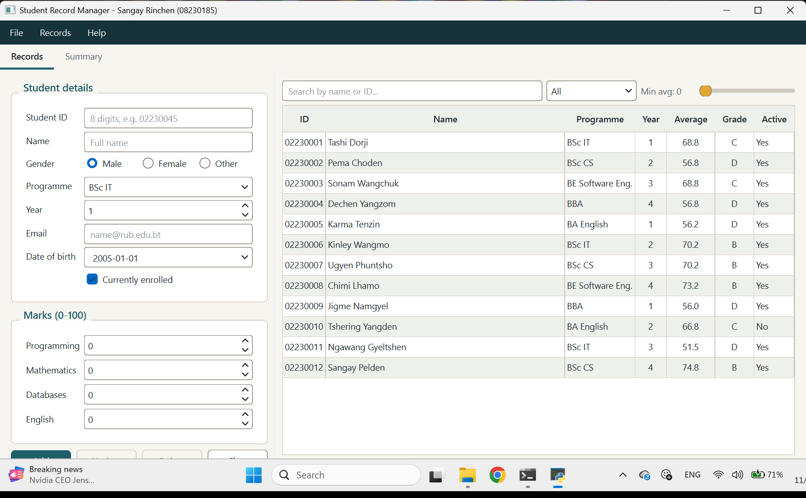

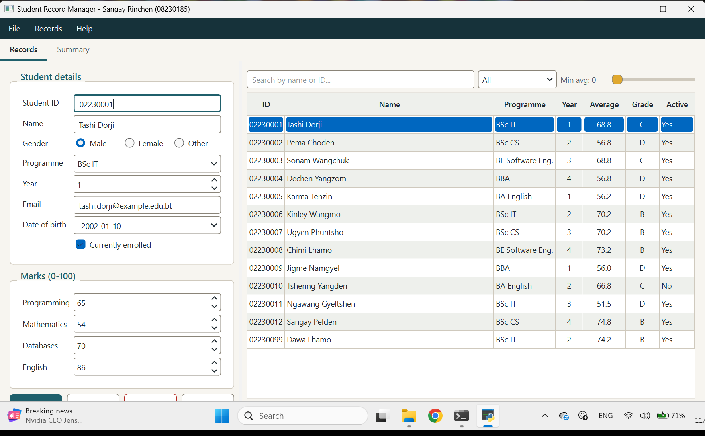

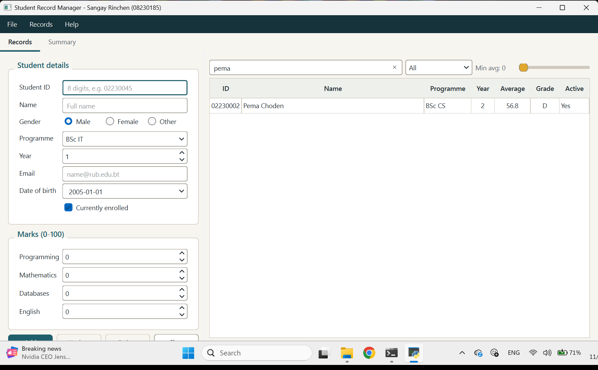

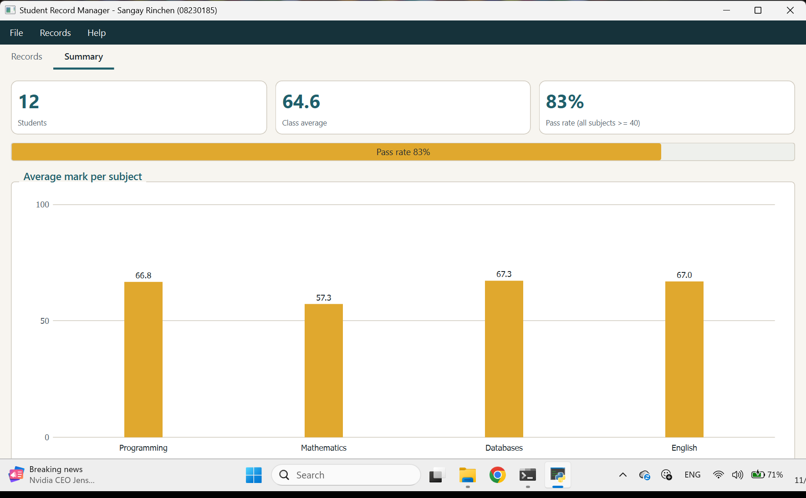

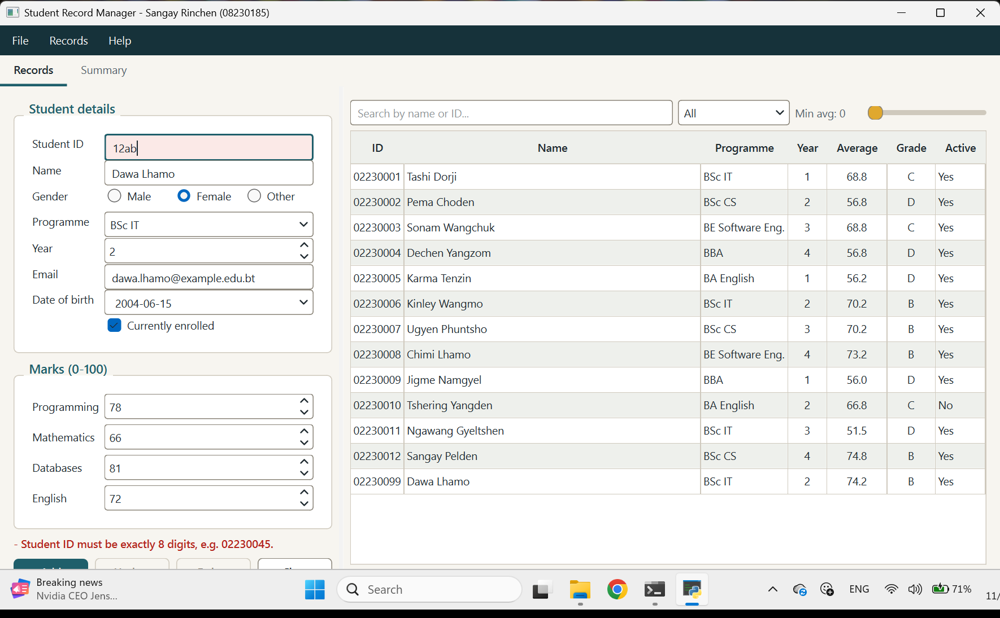

<div class="shots2">

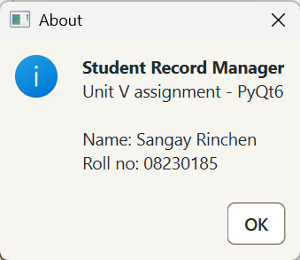

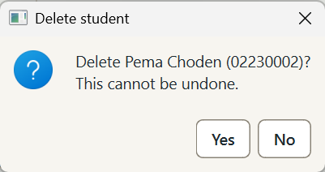

</div>

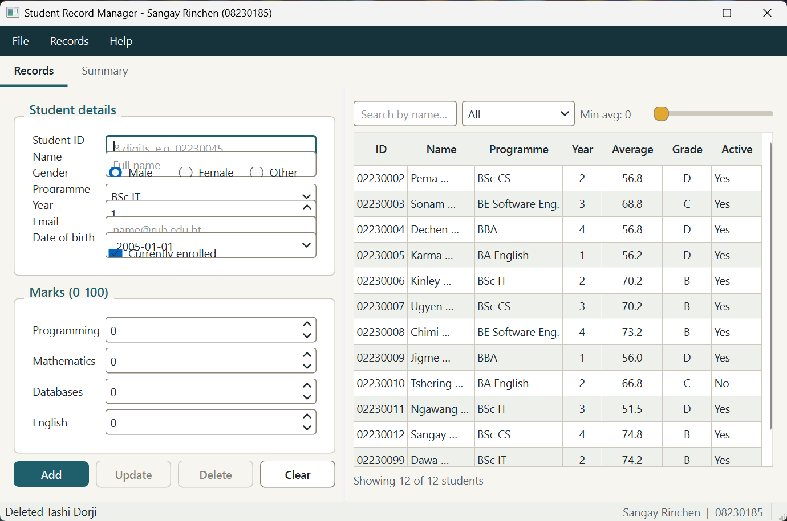

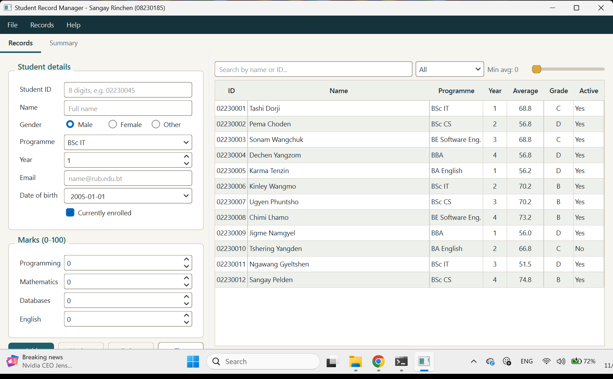

## 8. Challenges and reflection

**Problem 1 - The stylesheet removed the spin-box and combo-box arrows.** As soon as I gave `QSpinBox` and `QComboBox` a custom border in the style sheet, Qt stopped drawing the native arrow buttons, leaving empty boxes. *Solution:* I drew two small SVG chevrons and styled `::up-arrow`, `::down-arrow` and `::drop-down` to use them. A style sheet `url()` is resolved relative to the working directory, and the rules forbid absolute paths. So `theme.qss` contains a `{UI_DIR}` placeholder, and `srm/ui/theme.py` replaces it with the real folder at start-up.

**Problem 2 - The disabled Delete button still looked active.** Delete and Update are disabled until a row is selected, but Delete stayed red. The rule `QPushButton#danger` is more specific than `QPushButton:disabled`, so it won. *Solution:* add `QPushButton#danger:disabled` (and `#primary:disabled`) to the disabled rule. Lesson: Qt Style Sheets follow CSS specificity, just like the web.

**Problem 3 - Data would vanish in the packaged executable.** With PyInstaller `--onefile`, `__file__` points to a temporary folder that is deleted when the program exits, so `data/students.json` would have been written there and lost. The first build also failed because `--add-data` paths are resolved relative to the `.spec` file. *Solution:* `config.py` checks `sys.frozen` and stores data beside the executable; the theme files are bundled with `--add-data`.

**Problem 4 (environment) - Tkinter was missing.** The Python 3.13 build on the test machine had no `tkinter` module. *Solution:* I installed the OS package `python3-tk` and ran the Tkinter hello-world under Python 3.12. This was a reminder that "standard library" does not always mean "always installed".

**What I would do differently.** I would use `QTableView` with a custom `QAbstractTableModel` instead of `QTableWidget`, so the table reads straight from the repository without being rebuilt on every keystroke; with thousands of students, that rebuild would become slow. I would also use **SQLite** instead of JSON once records need relational data such as per-semester marks. Finally, I would design the form in Qt Designer to compare the `.ui` workflow with hand-written layouts.

**Would I still pick PyQt?** Yes, for this problem. The table, date picker, spin boxes and style sheets saved a lot of work compared with Tkinter, and Kivy's touch-first widgets did not fit an office data-entry tool. For a closed-source release I would switch to PySide6 for its LGPL licence; for a classroom tablet app I would choose Kivy.

## 9. References

1. Riverbank Computing. *PyQt6 Reference Guide*. https://www.riverbankcomputing.com/static/Docs/PyQt6/
2. The Qt Company. *Qt for Python (PySide6) documentation*. https://doc.qt.io/qtforpython-6/
3. The Qt Company. *Qt Style Sheets Reference* and *Layout Management*. https://doc.qt.io/qt-6/stylesheet-reference.html
4. Kivy organisation. *Kivy documentation (stable)*. https://kivy.org/doc/stable/
5. Python Software Foundation. *tkinter - Python interface to Tcl/Tk*. https://docs.python.org/3/library/tkinter.html
6. wxPython team. *wxPython documentation*. https://docs.wxpython.org/
7. Gradio. *Gradio documentation*. https://www.gradio.app/docs
8. Snowflake / Streamlit. *Streamlit documentation*. https://docs.streamlit.io/
9. PyInstaller. *PyInstaller manual*. https://pyinstaller.org/en/stable/
10. Python Software Foundation. *unittest - Unit testing framework*. https://docs.python.org/3/library/unittest.html

### AI assistance disclosure

As the assignment rules require, all significant AI assistance is listed here. **Claude (Anthropic), used through Claude Code, November 2026**, generated a first version of:

| Part | Files / sections | My own work on it |
|---|---|---|
| Application code | `main.py`, `srm/config.py`, `srm/models.py`, `srm/storage.py`, `srm/ui/main_window.py`, `srm/ui/chart.py`, `srm/ui/theme.py`, `srm/ui/theme.qss` | *(describe what you read, changed, re-typed and tested)* |
| Hello-world programs | `partA/hello_pyqt.py`, `hello_kivy.py`, `hello_tkinter.py` | *(describe)* |
| Tests | `tests/test_logic.py`, `tools/gui_tests_and_screenshots.py` | *(describe)* |
| Report | Draft text for sections 1-8, diagrams and wireframes | *(describe)* |

I have read every line of the submitted code and can explain and modify it.
